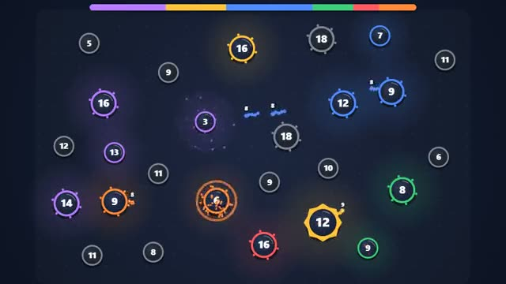

# Node Conquest

Grow troops, send them out, take the whole map. A multiplayer starter game from [Multiplayer Agent](https://multiplayeragent.com): 2D, versus, 2–6 players, with bots that take the empty seats.

## How it plays

Your bases grow troops on their own. Drag from one of your bases to any other to send half its troops: more than the defenders and it's yours. Knock everyone off the map, or have the most troops when the clock runs out.

**Controls:** Drag from your base to a target (sweep over more of your bases to send from all), or tap your base then tap the target.

## Make it yours in the Game Builder

Open the [Game Builder](https://multiplayeragent.com), choose **Start from a starter game** and pick Node Conquest. It opens as version 1 in your studio, ready to play and publish. Then ask for changes, for example:

- Add a tower base that shoots troops marching past
- Make it a space map with planets instead of bases
- Let players upgrade a base to grow faster

## Run it yourself

1. Get a free publishable key (`pk_…`) at [multiplayeragent.com](https://multiplayeragent.com).
2. In `index.html`, put it in place of `pk_REPLACE_ME` in the `MP_CONNECT` block.
3. Open `index.html` in a browser. No build step and no server needed.

Without a key it still runs, offline against bots.

## How it is built

- One `index.html`. The comment at the top of the script maps the code and explains the multiplayer.
- **Host-run rules:** The host's browser grows every base, marches every troop and decides every capture; if it leaves, the next player takes over.
- **Bots:** Bots take the empty seats, and a friend who joins takes over a bot that is still in the fight.
- **Live sync:** Everyone sees the same map, about 10 updates a second, with marching troops kept smooth in between.
- **Leaderboard:** Most wins, shown after every match.
- `?attract` runs it offline, six bots against each other. The preview video is recorded from it.

## License

MIT.
